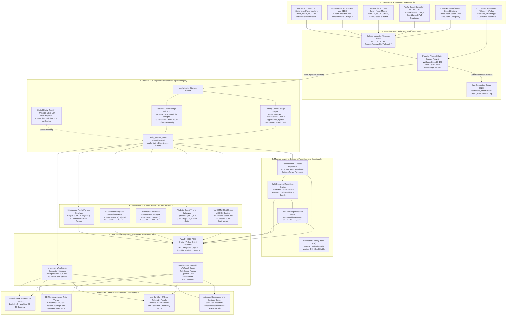

# Digital Twin-Enabled Smart City Analytics Platform

> **Document Status:** Authoritative System Documentation & Production Architecture  
> **Platform Classification:** Read-Only Municipal Decision-Support System  
> **Reference Pilot Corridor:** Viman Nagar Chowk to Somnath Nagar Chowk (1.8 km arterial corridor, Nagar Road, Pune, Maharashtra)  
> **Generalization Contract:** Open, modular urban analytics platform scalable to any municipal arterial network worldwide

---

## 1. Executive Summary

This **Digital Twin-Enabled Smart City Analytics Platform** is an evidence-backed urban decision-support and predictive intelligence system that couples road traffic mobility, commercial electrical microgrids, and ambient air quality into an integrated operational engine.

The platform continuously mirrors physical infrastructure conditions using event-driven MQTT sensor telemetry, forecasts speeds and energy demands 15, 30, and 60 minutes ahead via extreme gradient-boosted trees (XGBoost) with distribution-free Conformal Prediction uncertainty bands, and provides a microscopic what-if simulation sandbox (Eclipse SUMO) where city planners test mobility interventions in software before physical implementation.

**Core Operational Contract: Strict Non-Actuation**  
The platform is strictly a **read-only decision-support advisory system**. It will never autonomously actuate physical traffic signals or trip electrical substation breakers. All recommendations require explicit human inspection and authorization by certified municipal engineers outside the platform before any field action is taken.

---

## 2. Comprehensive System Architecture

The platform is engineered as a high-concurrency modular monolith with a resilient dual-engine persistence layer, real-time WebSocket distribution fabric, and an accessible React 18 / 3D Cesium photogrammetric operations console.

### 2.1 End-to-End System Architecture Flowchart



---

### 2.2 Text Architecture Representation

```text
+---------------------------------------------------------------------------------------------------+
|                            TIER 1: IOT SENSOR & TELEMETRY SOURCES                                 |
|  - Inductive Loops / Radar Speed Detectors (Velocity, Flow Rate, Detector Occupancy)              |
|  - Traffic Signal Controllers NTCIP 1202 (Active Phase, Stage Countdown, SPaT Broadcasts)         |
|  - Commercial 3-Phase Smart Meters (415V LL, 3600A Current, Active/Reactive Power)                |
|  - Rooftop Solar PV Inverters & BESS (Active Generation kW, Battery State of Charge %)            |
|  - CAAQMS Ambient Air Quality Stations (PM2.5, PM10, NO2, CO, Temperature, Wind Vector)          |
|  - In-Process Autonomous Telemetry Streamer (telemetry_streamer.py: 2.0s Diurnal Heartbeat)       |
+---------------------------------------------------------------------------------------------------+
                                                  |
                                                  v
+---------------------------------------------------------------------------------------------------+
|                     TIER 2: INGESTION TRANSPORT & PHYSICAL SANITY FIREWALL                        |
|  - Eclipse Mosquitto MQTT Broker: Topics corridor/{domain}/{entityId}/telemetry                   |
|  - Pydantic Bounds Firewall: Speed [0, 120] km/h, Power >= 0, Timestamps <= Now                  |
|  - Dead-Letter Queue (DLQ): Rejected packets routed to quarantine_observations table              |
+---------------------------------------------------------------------------------------------------+
                                                  |
                                                  v
+---------------------------------------------------------------------------------------------------+
|                 TIER 3: RESILIENT DUAL-ENGINE PERSISTENCE & SPATIAL REGISTRY                      |
|  - Primary Engine: PostgreSQL 16 + TimescaleDB Hypertables + PostGIS Spatial Geometries           |
|  - Resilient Fallback Engine: SQLite 3 (WAL Mode) via aiosqlite (29 Relational Tables)            |
|  - Fast Cache: entity_current_state table for sub-millisecond retrieval of all corridor assets   |
|  - Spatial Registry: FIWARE NGSI-LD standardized entities (RoadSegment, Intersection, Building)   |
+---------------------------------------------------------------------------------------------------+
                                                  |
                                                  v
+---------------------------------------------------------------------------------------------------+
|                     TIER 4: CORE ANALYTICS, PHYSICS & SIMULATION ENGINES                          |
|  - Indo-HCM (IRC:106) & US HCM Engine: Dual-criteria Speed and V/C matrix, PCU equivalence        |
|  - Webster Signal Timing Optimizer: Minimum delay cycle time C_0 = (1.5L + 5)/(1 - Y)             |
|  - 3-Phase AC Kirchhoff Power Balance: P = sqrt(3)*V*I*cos(phi), Feeder Headroom Evaluation       |
|  - Environmental Engine: CPCB piecewise linear AQI interpolation, Isolation Forest anomaly scoring|
|  - Microscopic Simulation Sandbox: Eclipse SUMO 1.20 (TraCI) + Verified Kinematic Fallback Runner |
+---------------------------------------------------------------------------------------------------+
                                                  |
                                                  v
+---------------------------------------------------------------------------------------------------+
|               TIER 5: PREDICTIVE AI, CONFORMAL UNCERTAINTY & EXPLAINABILITY (XAI)                 |
|  - Multi-Horizon XGBoost Regressors: 15m, 30m, 60m Speed & Building Power Forecasters             |
|  - Split Conformal Prediction: Distribution-free 80% and 90% empirical coverage bands             |
|  - TreeSHAP Explainable AI: Top-5 additive feature attribution decompositions                     |
|  - Observability: Population Stability Index (PSI) drift monitoring (PSI < 0.10 Stable)           |
+---------------------------------------------------------------------------------------------------+
                                                  |
                                                  v
+---------------------------------------------------------------------------------------------------+
|                     TIER 6: HIGH-CONCURRENCY API GATEWAY & TRANSPORT FABRIC                       |
|  - FastAPI 0.136 ASGI Engine (Python 3.11 + Uvicorn) serving asynchronous REST APIs               |
|  - In-Memory WebSocket Connection Manager: Pushes JSON-LD delta updates via /ws/operations        |
|  - Stateless Cryptographic JWT Authentication Guard with Role-Based Access Control (RBAC)         |
+---------------------------------------------------------------------------------------------------+
                                                  |
                                                  v
+---------------------------------------------------------------------------------------------------+
|                 TIER 7: OPERATIONS COMMAND CONSOLE & HUMAN-IN-THE-LOOP GOVERNANCE                  |
|  - Tactical 2D GIS Operations Canvas: Leaflet 1.9 with dynamic speed-based polyline color coding  |
|  - 3D Photogrammetric Twin Viewer: CesiumJS 1.120 with 3D terrain and speed-matched kinematics    |
|  - Recharts 2.12 Visualizations: Multi-horizon forecasts, conformal bands, 24h load profiles      |
|  - Advisory Governance Center: Strict Non-Actuation review, candidate approval, SHA-256 audit log|
+---------------------------------------------------------------------------------------------------+
```

---

### 2.3 Detailed Architectural Tier Breakdown

1. **Tier 1: IoT Sensor and Autonomous Telemetry Tier**
   - Ingests direct measurements from induction loops, traffic signal controllers emitting SPaT over NTCIP 1202, commercial 3-phase power meters (415V line-to-line, 3600A), rooftop solar inverters, battery storage (BESS), and CAAQMS air quality stations.
   - For offline evaluation and testing without field permits, the **In-Process Autonomous Telemetry Streamer** (`backend/ingestion/telemetry_streamer.py`) computes physics-informed telemetry every 2.0 seconds based on diurnal commuter Gaussian rush curves and electrical impedance equations.
   - Emits and tracks **32 distinct physical and derived engineering metrics** across the four coupled infrastructure domains.

2. **Tier 2: Ingestion Guard and Physical Sanity Firewall**
   - Transports sensor packets over standardized MQTT topics formatted as `corridor/{domain}/{entityId}/telemetry`.
   - The **Ingestion Guard** (`backend/ingestion/mqtt_consumer.py`) parses payloads against strict Pydantic v2 schemas and executes bounds checks (speed between 0 and 120 km/h, non-negative power, non-future timestamps).
   - Any packet violating physical laws or schema formatting is quarantined into `quarantine_observations` with an `INVALID` provenance tag, protecting analytics models from corrupted data.

3. **Tier 3: Resilient Dual-Engine Persistence and Spatial Registry**
   - **Dual-Engine Architecture:** In cloud deployments, connects to PostgreSQL 16 with TimescaleDB hypertables for time-series partitioning and PostGIS for spatial queries. For offline, field, and evaluation demonstrations, automatically falls back to an embedded **SQLite 3 Engine** (WAL mode via `aiosqlite`) containing all 29 relational tables.
   - **Fast State Cache:** Synchronously maintains the `entity_current_state` table, providing sub-millisecond lookups of the latest state for any corridor asset.
   - **Spatial Registry:** Standardizes all assets using FIWARE NGSI-LD URN specifications (`RoadSegment`, `Intersection`, `BuildingZone`, `AirQualityStation`).

4. **Tier 4: Core Analytics, Physics and Microscopic Simulation**
   - **Traffic Mobility:** Implements Greenshields hydrodynamic flow theory (`q = k * v`) and Indo-HCM (IRC:106) dual-criteria Level of Service (LOS) with Passenger Car Unit (PCU) equivalence for mixed traffic.
   - **Signal Optimization:** Implements F.V. Webster minimum-delay cycle time formulation: `C_0 = (1.5 * L + 5) / (1 - Y)` and allocates proportional green splits.
   - **Microgrid Power:** Computes 3-phase AC power physics (`P = sqrt(3) * V_LL * I_L * cos(phi)`), enforces Kirchhoff energy conservation (`P_grid + P_solar + P_bess = P_loads + P_losses`), and monitors 22kV feeder thermal ampacity and electrical headroom.
   - **Air Quality:** Computes official CPCB piecewise linear AQI interpolation and executes Scikit-Learn Isolation Forest anomaly detection (`s(x, n) = 2^(-E(h(x)) / c(n))`).
   - **Simulation Sandbox:** Integrates Eclipse SUMO 1.20 via Python TraCI with a verified kinematic fallback runner for what-if scenario testing.

5. **Tier 5: Machine Learning, Conformal Prediction and Explainability**
   - **Multi-Horizon Forecaster:** XGBoost extreme gradient-boosted tree regressors forecast traffic velocity and commercial building power at 15m, 30m, and 60m forward horizons using cyclical sine/cosine time features, autoregressive lags, and upstream queue states.
   - **Uncertainty Quantification:** Split Conformal Prediction calculates empirical non-conformity residuals on chronological calibration sets, yielding distribution-free 80% and 90% confidence bands without Gaussian assumptions.
   - **Explainable AI (XAI):** TreeSHAP decomposes predictions into the top-5 additive feature contributions (`f(x) = base_value + sum(shap_values)`).
   - **Model Observability:** Continuously tracks input feature drift using the Population Stability Index (`PSI < 0.10` Stable, `>= 0.25` Drift).

6. **Tier 6: High-Concurrency API Gateway and Transport Fabric**
   - High-performance FastAPI ASGI application running under Python 3.11 and Uvicorn.
   - Dedicated RESTful routes under `/api/v1` for corridor queries, live operations, analytics, recommendations, scenarios, evaluation benchmarks, and provisioning.
   - In-memory WebSocket Connection Manager broadcasting JSON-LD delta updates via `/ws/operations` every 2.0 seconds.
   - Stateless JWT authentication gateway with Role-Based Access Control (RBAC) supporting Traffic Operator, Grid Operator, Environmental Analyst, and Municipal Commissioner roles.

7. **Tier 7: Operations Command Console and Governance UI**
   - Built on React 18, TypeScript 5.5, and Vite 5.4.
   - Tactical 2D GIS map powered by Leaflet 1.9 with dynamic speed-based polyline color coding.
   - Immersive 3D Digital Twin Viewer powered by CesiumJS 1.120, rendering photogrammetric terrain, 3D extruded commercial buildings, and animated vehicles matched to physical sensor velocities.
   - Telemetry charts and forecast panels powered by Recharts 2.12.
   - **Advisory Governance Center:** Enforces the Strict Non-Actuation Invariant. Certified municipal engineers inspect recommendations, evaluate conflict matrices, and authorize intervention plans, with all approvals permanently written to a tamper-evident SHA-256 audit log.

---

## 3. Core Architectural Invariants

Every module, service, API endpoint, and UI component strictly preserves four non-negotiable architectural invariants:

1. **System of Record Invariant:** PostgreSQL/TimescaleDB (or the resilient local SQLite fallback engine) is the authoritative system of record. MQTT is message transport only.
2. **State Separation Invariant:** Ground truth observations (`LIVE`/`REPLAY`), physics simulations (`SIMULATION`), and machine learning predictions (`PREDICTED`) are strictly separated into distinct tables. Predictions and simulations never overwrite observed twin current state.
3. **Strict Non-Actuation Invariant:** The platform is read-only decision support. Recommendations are advisory and require human authorization by certified municipal engineers outside the platform before any field signal or electrical change.
4. **Mandatory Provenance Invariant:** Every dynamic value returned by APIs or displayed in the UI carries four mandatory metadata tags: `sourceMode` (`LIVE`, `REPLAY`, `SIMULATION`, `PREDICTED`, `STALE`), `observedAt`/`generatedAt`, engineering `unit`, and `qualityStatus` (`VALID`, `SUSPECT`, `CALIBRATED`, `INVALID`).
5. **Corridor Generalization Invariant:** The platform architecture, schemas, and UI are fully generalized for any municipal arterial corridor deployment worldwide. The 1.8 km Nagar Road reference pilot serves strictly as an empirical demonstration and calibration instance.

---

## 4. Complete Technical Stack

| Layer | Component | Approved Technology | Role & Exact Codebase Location |
| :--- | :--- | :--- | :--- |
| **Frontend Framework** | Application Shell | React 18 + TypeScript 5.5 | Reactive UI component tree and state management (`frontend/src/App.tsx`). |
| **Frontend Bundler** | Build Tool | Vite 5.4 | High-speed HMR and optimized production bundling (`frontend/vite.config.ts`). |
| **3D Twin Viewer** | Photogrammetric 3D | CesiumJS 1.120 | 3D photogrammetric terrain, extruded buildings, vehicle kinematics (`CesiumCorridorViewer.tsx`). |
| **2D Operational GIS** | Tactical GIS Map | Leaflet 1.9 / MapLibre GL JS | 2D corridor GIS rendering with dynamic road polylines (`MapOperationsView.tsx`). |
| **Telemetry UI** | Charts & Forecasts | Recharts 2.12 | Renders multi-horizon forecasts, conformal bands, and load curves (`ForecastPanel.tsx`). |
| **Icons & Styling** | Vector Design Tokens | Lucide React + Tailwind CSS | Accessible vector iconography (zero emojis) and responsive design tokens (`frontend/src/index.css`). |
| **Backend API Engine** | Modular Monolith | FastAPI 0.136 | Asynchronous ASGI RESTful endpoints and WebSocket controllers (`backend/main.py`). |
| **Web Server** | ASGI Server | Uvicorn 0.30 | High-concurrency asynchronous server running Python 3.11 (`backend/main.py`). |
| **Data Validation** | Schema Bounds Guard | Pydantic v2 (2.8) | Strict request/response validation and physical bounds checking (`backend/schemas/`). |
| **Database ORM & Driver** | Relational Access | SQLAlchemy 2.0 + aiosqlite | Asynchronous database connection pooling, migrations, and queries (`backend/core/database.py`). |
| **Time-Series Persistence** | Dual-Engine Database | PostgreSQL 16 / TimescaleDB | Hypertables with automatic, resilient local SQLite fallback (`digital_twin.db`). |
| **Message Transport** | Sensor Telemetry Bus | Eclipse Mosquitto (MQTT 3.1.1/5.0) | High-throughput publish/subscribe telemetry transport (`backend/ingestion/mqtt_consumer.py`). |
| **Telemetry Generator** | Autonomous Worker | Python Asyncio | In-process physical telemetry generator (`backend/ingestion/telemetry_streamer.py`). |
| **Machine Learning** | Tabular Forecaster | XGBoost 2.1 | Multi-horizon 15m/30m/60m speed and power forecasting (`ml/inference/forecaster.py`). |
| **Uncertainty Engine** | Coverage Bands | Split Conformal Prediction | Distribution-free 80% and 90% confidence bands without Gaussian assumptions (`ml/conformal.py`). |
| **Explainable AI (XAI)** | Feature Attribution | TreeSHAP (SHAP 0.46) | Decomposes forecasts into top-5 feature attributions (`ml/explainer.py`). |
| **Anomaly Detection** | Unsupervised ML | Scikit-Learn 1.5 | Isolation Forest scoring on environmental sensor streams (`backend/services/anomaly_detector.py`). |
| **Traffic Simulation** | Microscopic Physics | Eclipse SUMO 1.20 via TraCI | Microscopic car-following simulation with kinematic fallback runner (`simulation/runner.py`). |
| **Security & Auth** | Role-Based Access | Python-Jose + BCrypt | Stateless JWT tokens, role-based tab access, and audit log signing (`backend/api/v1/endpoints/auth.py`). |

---

## 5. Master Documentation Suite (4 Volumes)

The repository provides a complete 4-volume engineering handbook and evaluation briefing suite in both Markdown and publication-grade PDF format:

1. **Volume 1: System Architecture and Data Flow**
   - [Markdown](docs/Volume_1_System_Architecture.md) | [PDF](docs/Volume_1_System_Architecture.pdf)
   - Complete technical stack, implementation reality breakdown, end-to-end data pipeline, data provenance vocabulary, master inventory of all 32 emitted physical metrics, and municipal ROI.
2. **Volume 2: Domain Engineering and Mathematical Foundations**
   - [Markdown](docs/Volume_2_Domain_Engineering_and_Math.md) | [PDF](docs/Volume_2_Domain_Engineering_and_Math.pdf)
   - First-principles mathematical derivations: Greenshields traffic continuum, Indo-HCM (IRC:106) dual-criteria Level of Service, Webster minimum delay signal optimization, Green Wave progression offsets, 3-phase AC Kirchhoff power balance, feeder thermal headroom, CPCB AQI linear interpolation, Isolation Forest anomaly scoring, Conformal Prediction, and TreeSHAP.
3. **Volume 3: Screen-by-Screen Operator Manual and UI Guide**
   - [Markdown](docs/Volume_3_Screen_Operator_Guide.md) | [PDF](docs/Volume_3_Screen_Operator_Guide.pdf)
   - Granular manual for all 11 application views: explains every button, toggle, and click action; explains every number, gauge, and badge; explains Persistence Baselines, Gain vs Base, Forecast Skill Scores, and XGBoost vs neural networks.
4. **Volume 4: Judge Defense, Critical Q&A, Demo Script, and Forensic Audit**
   - [Markdown](docs/Volume_4_Judge_Defense_and_Script.md) | [PDF](docs/Volume_4_Judge_Defense_and_Script.pdf)
   - 20 bulletproof answers to the hardest technical judge questions, screen-by-screen live demonstration script with simple words and visual pause cues, and the complete Forensic Architecture and Flaws Resolution Dossier.

---

## 6. Active Future Enhancement Tracks (21 GitHub Issues)

The platform is expanding through two prioritized enhancement tracks covering 21 detailed engineering tasks:

### Track 1: Intelligent Traffic Mobility & Adaptive Control (11 Tasks)
Detailed directory: [docs/tasks/traffic-mobility/](docs/tasks/traffic-mobility/)

| Task ID | Issue | Task Title | Spec Ref | Milestone | Component / Scope |
| :--- | :--- | :--- | :--- | :--- | :--- |
| `TASK-01` | [#2](https://github.com/AshrafGalaxy/Digital_Twin/issues/2) | Canonical Level of Service (LOS) & Hydrodynamic State Engine | Section 7.1 | Milestone 1 | Backend & Telemetry |
| `TASK-08` | [#3](https://github.com/AshrafGalaxy/Digital_Twin/issues/3) | Real-Time Signal Phase and Timing (SPaT) Controller Feed Adapter | Section 7.3 | Milestone 1 | Backend & Telemetry |
| `TASK-07` | [#4](https://github.com/AshrafGalaxy/Digital_Twin/issues/4) | Critical Infrastructure Structural Health Monitoring (SHM) Pipeline | Section 10.1 | Milestone 1 | Backend & Telemetry |
| `TASK-11` | [#5](https://github.com/AshrafGalaxy/Digital_Twin/issues/5) | Location-Agnostic Study Area Onboarding & Network Topology Importer | Section 5 | Milestone 1 | Architecture & Backend |
| `TASK-02` | [#6](https://github.com/AshrafGalaxy/Digital_Twin/issues/6) | Webster Delay-Minimizing Adaptive Signal Timing Optimizer | Section 9.1 | Milestone 2 | Simulation & Control |
| `TASK-03` | [#7](https://github.com/AshrafGalaxy/Digital_Twin/issues/7) | Arterial Two-Way Green Wave Progression & Offset Optimizer | Section 9.2 | Milestone 2 | Simulation & Control |
| `TASK-04` | [#8](https://github.com/AshrafGalaxy/Digital_Twin/issues/8) | SUMO TraCI Multimodal Transit Bus Routes & Priority Simulation | Section 7.2 | Milestone 2 | Simulation & Modeling |
| `TASK-05` | [#9](https://github.com/AshrafGalaxy/Digital_Twin/issues/9) | Multi-Horizon Quantile Queue Length Forecaster (XGBoost + TreeSHAP) | Section 8.1 | Milestone 3 | Machine Learning |
| `TASK-06` | [#10](https://github.com/AshrafGalaxy/Digital_Twin/issues/10) | Multimodal Transit Stop Crowd Flow & Dynamic Dwell Time Forecaster | Section 8.2 | Milestone 3 | Machine Learning |
| `TASK-09` | [#11](https://github.com/AshrafGalaxy/Digital_Twin/issues/11) | Deck.gl 3D Animated Signal Head & Approach Lane Queue Visualizer | Section 7.3, 11 | Milestone 4 | Frontend & UI |
| `TASK-10` | [#12](https://github.com/AshrafGalaxy/Digital_Twin/issues/12) | Human-in-the-Loop Operator Advisory Dossier & Audit Trail UI | Section 9.1, 9.2 | Milestone 4 | Frontend & UI |

### Track 2: Energy Management & Microgrid Optimization (10 Tasks)
Detailed directory: [docs/tasks/energy-microgrid/](docs/tasks/energy-microgrid/)

| Task ID | Issue | Task Title | Spec Ref | Milestone | Component / Scope |
| :--- | :--- | :--- | :--- | :--- | :--- |
| `ENERGY-01` | [#13](https://github.com/AshrafGalaxy/Digital_Twin/issues/13) | Canonical Electrical Network Topology & Multi-Asset Telemetry Engine | Section 4, 5, 6 | Milestone 5 | Backend & Telemetry |
| `ENERGY-02` | [#14](https://github.com/AshrafGalaxy/Digital_Twin/issues/14) | Electrical Bus Power Balance & Feeder Thermal Loading Engine | Section 7.1 | Milestone 5 | Backend & Telemetry |
| `ENERGY-03` | [#15](https://github.com/AshrafGalaxy/Digital_Twin/issues/15) | 2R-2C ETP Building Thermal Network & Dynamic Occupancy Setback Engine | Section 7.2, 7.3 | Milestone 6 | Simulation & Control |
| `ENERGY-05` | [#16](https://github.com/AshrafGalaxy/Digital_Twin/issues/16) | Solar PV Generation & Irradiance Physical Forecasting Engine | Section 8.2 | Milestone 6 | Machine Learning |
| `ENERGY-04` | [#17](https://github.com/AshrafGalaxy/Digital_Twin/issues/17) | Multi-Horizon Quantile Facility Load Forecaster (15m to 24h) | Section 8.1 | Milestone 7 | Machine Learning |
| `ENERGY-06` | [#18](https://github.com/AshrafGalaxy/Digital_Twin/issues/18) | BESS Battery Arbitrage & Time-of-Use Peak Shaving Optimizer | Section 9.1 | Milestone 7 | Optimization & Control |
| `ENERGY-07` | [#19](https://github.com/AshrafGalaxy/Digital_Twin/issues/19) | Grid Safety Interlocks & OpenADR / Modbus Failsafe Dispatch Gateway | Section 9.2, 9.3 | Milestone 8 | Backend & Telemetry |
| `ENERGY-08` | [#20](https://github.com/AshrafGalaxy/Digital_Twin/issues/20) | Interactive Microgrid Single-Line Diagram (SLD) & Power Flow Canvas | Section 4, 11 | Milestone 8 | Frontend & UI |
| `ENERGY-09` | [#21](https://github.com/AshrafGalaxy/Digital_Twin/issues/21) | Building Floorplate 3D/2D Thermal Comfort & Occupancy Visualizer | Section 7.2, 11 | Milestone 8 | Frontend & UI |
| `ENERGY-10` | [#22](https://github.com/AshrafGalaxy/Digital_Twin/issues/22) | Human-in-the-Loop Demand-Response Advisory Dossier & Audit UI | Section 9.2, 10 | Milestone 8 | Frontend & UI |

---

## 7. Quickstart: Running the Platform

### Option A: Local Development (Windows / PowerShell)
```powershell
# Starts FastAPI backend (port 8000) and Vite frontend (port 5173) in parallel
.\start_dev.ps1
```

### Option B: Docker Compose
```bash
# Core platform (PostgreSQL, Mosquitto, Backend, Frontend)
docker compose up -d

# Full research platform (includes MinIO and MLflow)
docker compose --profile full up -d
```

### Access URLs:
- **Operations Dashboard:** [http://localhost:5173](http://localhost:5173)
- **Backend API Documentation:** [http://localhost:8000/docs](http://localhost:8000/docs)
- **Health Check Endpoint:** [http://localhost:8000/health](http://localhost:8000/health)
- **Real-Time WebSocket Stream:** `ws://localhost:8000/ws/operations`

---

## 8. Repository Directory Structure

```text
├── .github/                        # GitHub Actions CI, issue & PR templates
│   ├── ISSUE_TEMPLATE/             # Domain task issue template
│   ├── workflows/                  # ci.yml (Tests, TypeScript build, asset validation)
│   └── pull_request_template.md    # Standard PR template with architectural invariants
├── FuturePlans/                    # Master domain enhancement specifications
│   ├── TRAFFIC_MANAGEMENT.md       # Intelligent Traffic Mobility & Control blueprint
│   ├── ENERGY_MANAGEMENT.md        # Microgrid & Energy Management blueprint
│   ├── ENVIRONMENT_MANAGEMENT.md   # Air quality & environmental monitoring blueprint
│   ├── WATER_MANAGEMENT.md         # Municipal water distribution blueprint
│   └── WASTE_MANAGEMENT.md         # Solid waste collection & routing blueprint
├── docs/                           # Architecture blueprints, master handbook & task directories
│   ├── Volume_1_System_Architecture.md # Vol 1: Architecture, data flow & 32 metrics catalog
│   ├── Volume_2_Domain_Engineering_and_Math.md # Vol 2: First-principles physics & mathematical derivations
│   ├── Volume_3_Screen_Operator_Guide.md # Vol 3: Exhaustive screen-by-screen operator & UI manual
│   ├── Volume_4_Judge_Defense_and_Script.md # Vol 4: 20 judge Q&As, live demo script & forensic audit
│   ├── architecture.md             # Technical architecture and DB schemas
│   └── tasks/                      # Modular engineering implementation task directories
│       ├── traffic-mobility/       # 11 engineering tasks for Traffic Mobility (Tasks 01 to 11)
│       └── energy-microgrid/       # 10 engineering tasks for Energy Management (Tasks 01 to 10)
├── data/                           # Corridor GIS assets, spatial registry, and manifests
│   ├── manifests/                  # Data catalogs and governance definitions
│   └── spatial/                    # GeoJSON corridor networks and PostGIS geometries
├── backend/                        # FastAPI modular monolith application
│   ├── api/v1/                     # REST and WebSocket endpoints
│   ├── core/                       # Config, database connections, schema migrator
│   ├── ingestion/                  # Telemetry streamers, MQTT consumers, validators
│   ├── models/                     # Data models and entities
│   ├── schemas/                    # Pydantic serialization schemas
│   └── services/                   # Business logic, rule engine, scenarios, forecasts
├── frontend/                       # React 18 + TypeScript + Vite operations UI
│   ├── src/components/             # UI components, Map views, Cesium 3D and modals
│   ├── src/services/               # API clients and WebSocket managers
│   └── src/types/                  # TypeScript interface definitions
├── simulation/                     # Eclipse SUMO networks, vehicle fleets, TraCI runners
├── ml/                             # XGBoost training pipelines, models, and evaluators
├── infrastructure/                 # Docker Compose, Mosquitto, and database configs
├── scripts/                        # Development utilities and synthetic stream runners
├── tests/                          # 25 modular pytest suites (183 hermetic tests)
├── CONTRIBUTING.md                 # Developer onboarding and contribution guidelines
├── AGENTS.md                       # Mandatory operating rules and architectural invariants
├── PRD.md                          # Executive Product Requirements Document
├── compose.yaml                    # Multi-container Docker Compose configuration
├── start_dev.ps1                   # One-click PowerShell local development launcher
└── README.md                       # Root system overview, architecture diagram & navigation
```

---

## 9. License & Ethics Notice

This project is an academic research and engineering prototype. Data from OpenStreetMap is licensed under the [Open Database License (ODbL)](https://opendatacommons.org/licenses/odbl/). All external benchmark datasets are cataloged with explicit licenses and restrictions in `data/manifests/DATASET_REGISTRY.md`.
