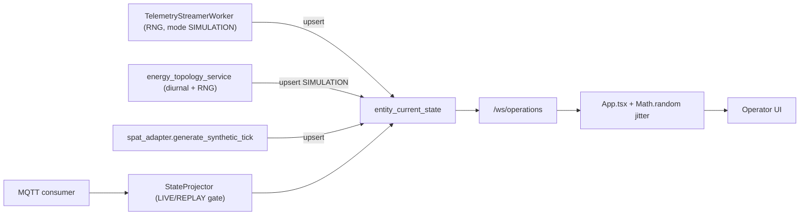
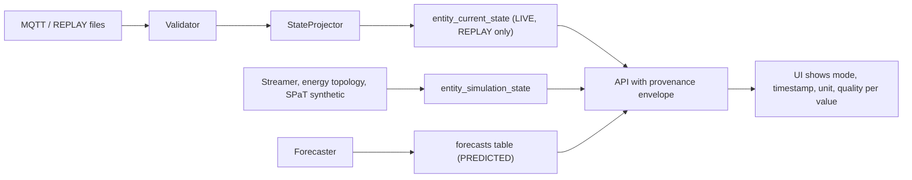

# 01. State Separation and Provenance

**Invariants concerned:**
- Section 2.2 (state separation)
- Section 2.5 (mandatory provenance)
- Section 3 (data honesty)

## Current data flow (as implemented)



Only one of the four writers into `entity_current_state` respects the gate.

## Target data flow



---

## Findings

### SP-01 (CRITICAL) Telemetry streamer writes SIMULATION into authoritative current state
- **Location:**
  - `backend/ingestion/telemetry_streamer.py` ~225-246 (segments), ~355-385 (buildings), ~440-450 (air quality), ~470-480 (signals)
  - `backend/core/config.py` lines 42-43 (`TELEMETRY_STREAMER_ENABLED = True`, `TELEMETRY_STREAMER_MODE = "SIMULATION"`)
- **Evidence:** `INSERT INTO entity_current_state (...) ON CONFLICT ... DO UPDATE` with `"source_mode": self.mode`. Values come from `random.uniform` and diurnal curves (~165-169, ~331-336).
- **Impact:** Observed twin state is overwritten by synthetic data every tick. This directly violates the state separation invariant, and every downstream consumer (LOS, rule engine, UI) reasons over fabricated state.
- **Fix:**
  - Create an `entity_simulation_state` table with the same shape, and route the streamer there when mode is SIMULATION.
  - Turn the streamer off by default in production config.
  - REPLAY mode must read recorded files (see SP-09) and go through `Validator` then `StateProjector`, never writing directly.

### SP-02 (CRITICAL) Energy topology engine upserts SIMULATION into current state
- **Location:** `backend/services/energy_topology_service.py` ~695-711.
- **Evidence:** `VALUES (..., 'SIMULATION', ...) ON CONFLICT ... SET source_mode = 'SIMULATION'`.
- **Fix:** Write to `entity_simulation_state` and `energy_asset_telemetry` (tagged SIMULATION) only.

### SP-03 (CRITICAL) SPaT synthetic ticks upsert into current state
- **Location:**
  - `backend/services/spat_adapter.py` ~321-335 (upsert)
  - ~361+ (`generate_synthetic_tick`)
  - driven from `telemetry_streamer.py` ~459
- **Fix:** Use the same routing as SP-01. Synthetic SPaT is SIMULATION and belongs in simulation state.

### SP-04 (CRITICAL) Database constraint permits any mode in current state
- **Location:** `infrastructure/postgres/init.sql` lines 95-106. The SQLite equivalent is in `backend/core/schema_migrator.py`.
- **Evidence:** The comment says "ONLY updated by LIVE and REPLAY observations", but the constraint is `CHECK (source_mode IN ('LIVE','REPLAY','SIMULATION','PREDICTED','STALE','INVALID'))`.
- **Fix:** Change the constraint to `CHECK (source_mode IN ('LIVE','REPLAY'))` in both dialects. Add a migration that moves existing SIMULATION rows into `entity_simulation_state`. Track STALE/INVALID as `quality_status`, not `source_mode`.

### SP-05 (CRITICAL) Historical snapshot endpoint relabels and fabricates REPLAY
- **Location:** `backend/api/v1/endpoints/state.py` line ~135 (forces `"sourceMode": "REPLAY"` on DB rows) and ~151-225 ("Calibrated Deterministic Diurnal Fallback").
- **Impact:** Synthetic values are presented as historical observations, and true SIMULATION rows are relabeled as REPLAY.
- **Fix:**
  - Return each row's stored `source_mode`.
  - When data is insufficient, return `200` with an empty `items` list and `qualityStatus: "EMPTY"`. Never synthesize.

### SP-06 (HIGH) Migrator seeds synthetic metrics labeled REPLAY
- **Location:** `backend/core/schema_migrator.py` ~953, ~990 (`_seed_initial_current_state`), ~1020 (energy seed).
- **Fix:** Seed only static asset registry data (geometry, capacities) from deployment config. Leave current state empty until real ingestion. If demo seed data is needed, put it behind an explicit `DEMO_SEED=true` flag, tagged SIMULATION, in the simulation table.

### SP-07 (HIGH) Quality status conflated with source mode
- **Location:** `backend/services/spat_adapter.py` ~132-133 sets `sourceMode = "STALE"`. Section 3 of AGENTS.md lists STALE/INVALID as modes, but the code mixes them inconsistently.
- **Fix:**
  - Keep `sourceMode` in {LIVE, REPLAY, SIMULATION, PREDICTED}.
  - Add a separate `qualityStatus` field in {VALID, STALE, INVALID, DEGRADED, EMPTY}.
  - Present STALE/INVALID in the UI from `qualityStatus`.
  - Document this mapping in the API schema.

### SP-08 (HIGH) STALE is evaluated only for LIVE
- **Location:** `backend/ingestion/validator.py` ~108, ~159.
- **Impact:** REPLAY current state never ages, so an operator cannot tell that the replay has stopped.
- **Fix:** Compute freshness against the replay clock for REPLAY, and against wall clock for LIVE. Apply the 180 s (traffic) and 900 s (energy) thresholds to both.

### SP-09 (HIGH) MQTT publisher tags sin/random values as REPLAY
- **Location:** `scripts/publish_stream.py` ~44-48, ~66-67.
- **Fix:** For REPLAY, read rows from a registered dataset file in timestamp order. Generated values may only use SIMULATION.

### SP-10 (HIGH) Missing `unit` in many API payloads
- **Location:**
  - traffic LOS provenance blocks (`backend/api/v1/endpoints/traffic.py`)
  - energy summary nested metrics (`backend/api/v1/endpoints/energy.py`)
  - `entity_current_state` has no unit column
  - `traffic_15m_aggregates` has no `source_mode` or quality columns
- **Fix:** Introduce a shared Pydantic model, require it in response models for every dynamic value, and mirror it in `frontend/src/types/twin.ts`:

```python
class ProvenancedValue(BaseModel):
    value: float | None
    unit: str
    sourceMode: Literal["LIVE", "REPLAY", "SIMULATION", "PREDICTED"]
    observedAt: datetime | None = None
    generatedAt: datetime | None = None
    qualityStatus: Literal["VALID", "STALE", "INVALID", "DEGRADED", "EMPTY"]
```

### SP-11 (HIGH) Frontend fabricates telemetry with Math.random
- **Location:** `frontend/src/App.tsx` lines 393-433.
- **Evidence:** `const delta = (Math.random() - 0.49) * 14.0;` and `speedJitter`. It also sets `updatedAt: new Date().toISOString()` and `setLastUpdated(new Date().toISOString())`. The code comment says the goal is to make values "feel organically alive".
- **Fix:** Delete the heartbeat effect. When the WebSocket goes quiet, show a STALE banner computed from the server `observedAt`.

### SP-12 (HIGH) Frontend seed KPIs presented as values
- **Location:** `frontend/src/App.tsx` ~169-170 (`liveEnergyKw = 4862.0`, `liveSensorsCount = 10`), ~446-447 (`avgSpeed = 42.5` default).
- **Fix:** Initialize to `null` and render `--` with an "Awaiting data" state.

### SP-13 (MEDIUM) Report generator invents provenance counts
- **Location:** `backend/services/report_generator.py` lines ~49-55 and ~76.
- **Evidence:** `if counts["LIVE"] == 0: counts["LIVE"] = 2`, `REPLAY = 14`, `PREDICTED = 4`, and SIMULATION inflated to `len(scenario_runs) * 2 + 3`.
- **Fix:** Report the actual counts, including zero.

### SP-14 (MEDIUM) Traffic LOS falls back to defaults but keeps observed provenance
- **Location:** `backend/api/v1/endpoints/traffic.py` ~83-90 (`FALLBACK_SEGMENTS`), ~139-140, ~175-176.
- **Fix:** Missing state should give `qualityStatus: "EMPTY"` with a null value. Do not substitute `default_speed` / `default_flow`.

### SP-15 (MEDIUM) Corridor LOS of empty input returns a healthy grade
- **Location:** `backend/services/los_engine.py` ~245-256 (returns LOS C, 35 km/h, V/C 0.50).
- **Fix:** Return `los: null`, `qualityStatus: "EMPTY"`.

### SP-16 (MEDIUM) Power balance returns static feeders when none exist
- **Location:** `backend/services/power_balance_service.py` ~190-232.
- **Fix:** Return an empty balance with `qualityStatus: "EMPTY"`.

### SP-17 (LOW) ProvenanceBadge tooltip weakens LIVE honesty
- **Location:** `frontend/src/components/ProvenanceBadge.tsx` ~34 ("field sensors or calibrated mock feed").
- **Fix:** LIVE should only mean a verified field feed. Remove "mock feed".

## Acceptance criteria for this area
- An automated test inserts SIMULATION and PREDICTED rows through every writer and asserts that `entity_current_state` rejects them (DB constraint) or never receives them (service routing).
- `grep -R "Math.random" frontend/src` returns only UI-only uses (reconnect jitter, scenario seed button).
- Every response model that carries a dynamic numeric value uses `ProvenancedValue` or equivalent fields.
