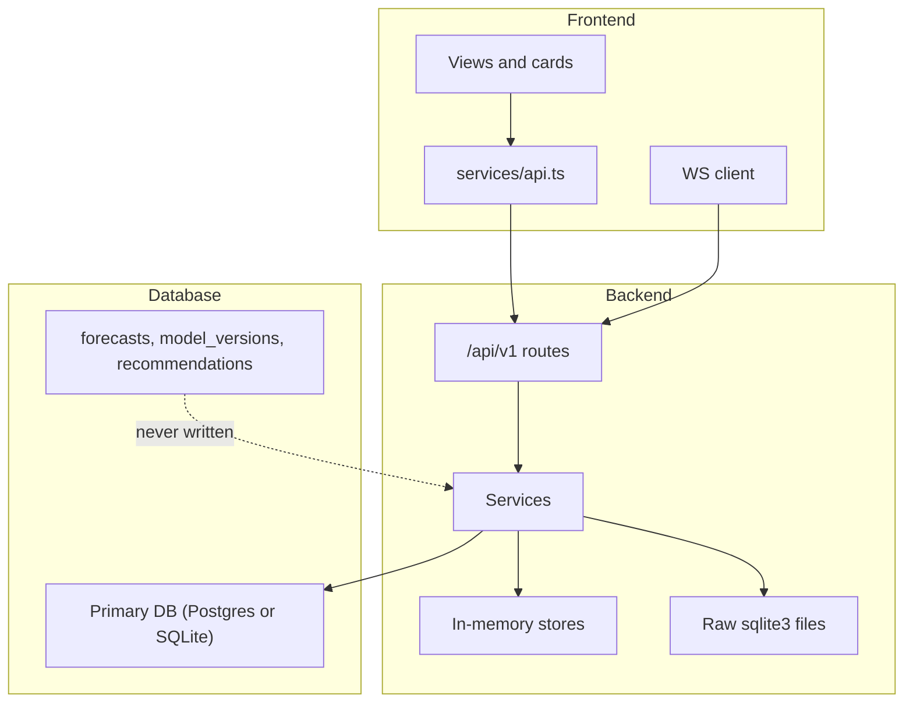

# 08. Integration Gaps: Frontend, Backend, Database

## Integration map (current)

---

## Findings

### INT-01 (CRITICAL) Auth state is not connected between frontend and backend
- **Evidence:** The frontend holds a JWT but never sends it, and the backend never checks it. See SEC-01 and SEC-07.
- **Fix:** Use one `apiFetch` with Bearer, backend `require_role`, and `/auth/verify` on load.

### INT-02 (CRITICAL) Governance actions are not durable
- **Evidence:** Authorizing an advisory in the UI updates an in-memory object in `rule_engine` / `energy_advisory_service`. The audit log insert is best effort, and a restart loses status.
- **Fix:** Persist recommendations and advisories (DB-06, DB-07). The UI reads status from the DB-backed endpoint after the action.

### INT-03 (HIGH) Forecasts are not persisted, so there is no forecast history or accuracy tracking
- **Evidence:** `/forecasts/traffic/{id}` and `/forecasts/energy/{id}` compute on demand, and the `forecasts` table is unused.
- **Fix:**
  - Write every forecast to `forecasts`.
  - Add a job that joins matured forecasts with later observations to compute rolling online MAE.
  - Expose `/forecasts/{entity}/history` and show forecast vs actual in the UI.

### INT-04 (HIGH) Model registry not connected
- **Evidence:** The `model_versions` table is unused, `/forecasts/models` builds data from in-memory metadata (with fake fallback metrics), and the frontend `fetchForecastModels` is unused.
- **Fix:** Training registers each artifact in `model_versions`. The API reads from the table, and the UI shows a model card (version, training data provenance, split, MAE/RMSE vs persistence, conformal coverage).

### INT-05 (HIGH) Drift monitoring has no UI
- **Evidence:** `/analytics/drift` exists, but no frontend consumer does.
- **Fix:** Add a drift panel to the System Health view (per-feature PSI, status, reference window, current window, row counts).

### INT-06 (HIGH) Scenario engine identity is dropped between simulation and UI
- **Evidence:** `simulation/runner.py` knows `engine_used`, but `scenario_service` drops it and the UI badge claims SUMO physics.
- **Fix:** Carry `engineUsed` through DB, API and UI (SIM-02).

### INT-07 (HIGH) Webster recommendations not persisted on Postgres
- See DB-01. The UI shows recommendations that disappear on reload in Postgres deployments.

### INT-08 (HIGH) Quarantine records go to a separate DB file
- **Evidence:** The `SystemHealthView` quarantine list reads from the main DB, while the validator writes to `data/quarantine.db`.
- **Fix:** DB-02.

### INT-09 (HIGH) Backend endpoints without UI consumers
| Endpoint | Value | Action |
|---|---|---|
| `/state/history` | Historical charts | Wire into the entity drawer trend chart |
| `/traffic/segment/{id}/los` | Segment LOS detail | Wire into the drawer |
| `/traffic/.../spat/history` | Phase timeline | Wire into the Webster modal |
| `/energy/feeders/thermal-margins` | Thermal headroom | Wire into FeederThermalLoadingCard |
| `/energy/power-balance/history` | Balance trend | Wire into energy view |
| `/analytics/rollups/traffic` | 15 min aggregates | Wire into traffic analytics |
| `/environment/stations` | Station registry | Wire into environment view |
| `/spatial/registry`, `/spatial/layers/{}`, `/spatial/resolve/{}` | Geometry | Replace hardcoded map geometry (FE-08) |
| `/scenarios/runs/{id}/compare` | Run comparison | Wire into the scenario studio |
| `/interop/ngsi-ld/*` | External interop | Keep API-only, document |
| canonical `/roads`, `/intersections`, `/entities`, `/observations`, `/models`, `/data-quality`, `/scenario-runs` | Duplicate of `/assets` and others | Consolidate or remove duplicates |

### INT-10 (MEDIUM) Duplicate resource families
- **Evidence:** `canonical_resources.py` duplicates `/assets`, `/scenarios` and `/forecasts/models` under different shapes.
- **Fix:** Keep one canonical family and deprecate the other.

### INT-11 (MEDIUM) TypeScript types are hand-maintained
- **Fix:** Generate them from OpenAPI in CI and fail the build on drift.

### INT-12 (MEDIUM) WebSocket payload is not versioned and lacks quality fields
- **Fix:** Define a WS message schema `{type, version, entityId, sourceMode, observedAt, qualityStatus, metrics: {name: {value, unit}}}`.

### INT-13 (MEDIUM) Replay and simulator control state not reflected in UI reliably
- **Evidence:** `fetchReplayStatus` returns a synthetic object on failure (FE-09).
- **Fix:** Make the server the source of truth, and broadcast status changes on `/ws/system`.

### INT-14 (MEDIUM) Study area config consumed inconsistently
- **Evidence:** `/study-area` exists, but many components use `config/corridorConfig.ts` constants.
- **Fix:** Load the study area once into a React context, and remove the static config.

### INT-15 (MEDIUM) Benchmarks file vs evaluation API
- See ML-14.

### INT-16 (LOW) `/auth/verify` unused
- Wire it on app load (SEC-07).

### INT-17 (LOW) NGSI-LD interop uses default coordinates
- See BE-21.

## Acceptance criteria
- Every table has at least one writer and one reader, or is removed.
- Every backend route is either consumed by the UI or documented as API-only.
- A contract test generates TS types from OpenAPI and compiles the frontend.
