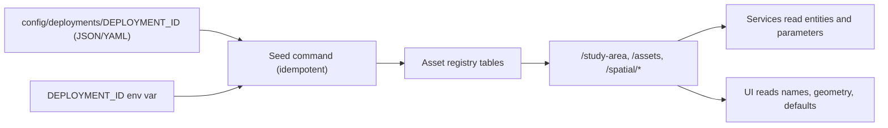

# 09. Hardcoding and Corridor Generalization

**Invariant concerned:** AGENTS.md Section 2.3 (Corridor Generalization). Reference pilot identifiers must be configurable deployment data, not code.

## Target design

The deployment package should contain:
- study area metadata (name, city, bounding box, centroid, timezone)
- segments (geometry, lanes, capacity, free-flow speed, saturation flow)
- intersections (phase plans, approach-to-phase mapping, pedestrian crossing widths, cycle bounds)
- facilities (contract demand, operating calendar, feeders, conductors, ratings)
- sensors and stations
- scenario templates
- SUMO network paths
- LOS policy and custom thresholds
- narrative copy for the pilot evaluation report

> Proposed new folder: `config/deployments/`. Per AGENTS.md Section 5, this structural change needs explicit approval before implementation.

---

## Findings: pilot identifiers in code

| ID | Severity | Location | Evidence |
|---|---|---|---|
| HC-01 | HIGH | `backend/ingestion/telemetry_streamer.py` ~28-58 | `CORRIDOR_SEGMENTS`, `SENSOR_STATIONS` with `PUNE:` URNs, capacities 2400/1400 |
| HC-02 | HIGH | `backend/api/v1/endpoints/traffic.py` ~83-90, ~349-357 | Segment and intersection demand catalogs |
| HC-03 | HIGH | `backend/services/rule_engine.py` ~60-62, ~274-336, ~371-385 | Entity IDs and place names in advisories |
| HC-04 | HIGH | `backend/services/spat_adapter.py` ~161-212 | Phase tables keyed by pilot intersections |
| HC-05 | HIGH | `backend/services/forecast_service.py` ~31-45 | Facility baselines (pilot buildings) |
| HC-06 | HIGH | `backend/services/energy_advisory_service.py` ~50-58 | Facility and BESS identifiers |
| HC-07 | HIGH | `backend/services/scenario_service.py` ~23-67, ~104 | Template copy and `ScenarioRun:PUNE:` IDs |
| HC-08 | HIGH | `backend/services/report_generator.py` ~89-194 | Report text, `REP-PUNE-NR-` IDs |
| HC-09 | HIGH | `backend/api/v1/endpoints/canonical_resources.py` ~119-163, ~193 | Pilot building SQL alias filters |
| HC-10 | HIGH | `backend/core/schema_migrator.py` ~686, ~905-1440 | Seeds and defaults |
| HC-11 | HIGH | `ml/features/*`, `ml/inference/forecaster.py` ~30-44, `ml/training/*` | Default entity URNs and contract kW |
| HC-12 | HIGH | `simulation/runner.py` ~33-34, ~108 | SUMO net path, TLS ID `VN-01` |
| HC-13 | MEDIUM | `backend/ingestion/weather_client.py` ~92-93 | Coordinates |
| HC-14 | MEDIUM | `backend/services/fiware_adapter.py` ~47, ~81, ~120 | Default coordinates |
| HC-15 | MEDIUM | `scripts/publish_stream.py` ~31-40 | Segment list |
| HC-16 | MEDIUM | Frontend views (see FE-28) | IDs, names, map center, metro polyline |
| HC-17 | MEDIUM | `frontend/src/config/corridorConfig.ts` | Static corridor constants |
| HC-18 | MEDIUM | `tests/test_persistence_adapter.py` ~100-118, `tests/test_pilot_evaluation.py` ~50-53 | City name, entity counts and length asserted as invariants |
| HC-19 | MEDIUM | README and MQTT topic examples | Pilot-specific topic prefix |
| HC-20 | LOW | `backend/scripts/seed_db.py` ~197 | Local DB URL |

## Findings: magic numbers to move into config or registry

| ID | Value | Location | Target |
|---|---|---|---|
| HC-21 | Saturation flow 1800 vph/lane | `signal_optimizer.py` ~27 | Per approach in the registry |
| HC-22 | Cycle bounds 60-150 s, Y cap 0.85 | `signal_optimizer.py` ~35-38, ~200 | Policy config (remove the cap, DOM-03) |
| HC-23 | Free-flow speed 50 km/h | `los_engine.py`, `validator.py` | Per segment |
| HC-24 | Segment capacities 2400/1400 vph | streamer, traffic fallbacks | Per segment |
| HC-25 | Thermal thresholds 0.75/0.90 | `power_balance_service.py` ~36-37 | Per feeder |
| HC-26 | Conductor 0.08 ohm/km, 750 m default | `power_balance_service.py` ~164-165 | Per feeder |
| HC-27 | Peak factor 0.85, contract kW | `forecaster.py` ~189, ~30-44 | Per facility |
| HC-28 | Forecast clamps (5-55 km/h, 1000-6500 kW) | `forecaster.py` ~138-140, ~245-247 | Artifact training range |
| HC-29 | Ambient default temperatures (28.5 C etc.) | `forecaster.py` ~69, ~180, drift SQL | Weather feed, else mark DEGRADED |
| HC-30 | Kinematic simulation demand and timing | `runner.py` ~167-254 | Scenario template |
| HC-31 | Training split ratios | ML modules | Single constant (0.80/0.10/0.10) |
| HC-32 | XGBoost hyperparameters | trainers | Versioned YAML |

## How to remove them safely (high level)

1. Define a JSON Schema for the deployment package, and validate it in CI.
2. Move the current pilot data into `config/deployments/reference-pilot/` as the reference demonstration instance.
3. Add `DEPLOYMENT_ID` to `Settings`. The seed command loads the package into the registry tables.
4. Replace each hardcoded catalog with a registry query (cached at startup, invalidated on reseed).
5. Frontend: load the study area into a React context, and remove `corridorConfig.ts` constants and hardcoded defaults.
6. Tests: create a second tiny synthetic deployment (for example 1 intersection, 2 segments) to prove the platform works with a different topology. Pilot-specific assertions move into a deployment-scoped test that loads the reference package.
7. CI guard: `rg -i "pune|viman|nagar road|phoenix|SEG-NR|INT-VN|INT-SN" backend ml simulation frontend/src --glob '!config/deployments/**'` must return nothing.
