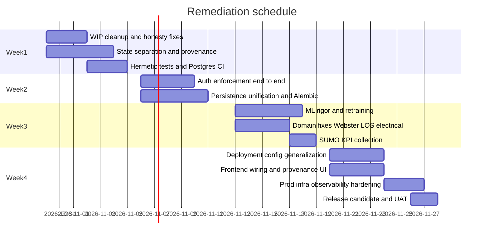

# 12. Production Readiness Roadmap (4 weeks)

**Goal:** a production-ready reference pilot that is honest, secure, durable and generalizable, within 4 weeks of 2026-10-29.

## Guiding order

1. Make it honest: no fabricated data, and strict state separation.
2. Make it secure: auth enforced end to end.
3. Make it durable: one persistence path, with migrations.
4. Make it correct: ML and domain logic fixes.
5. Make it general: deployment config instead of hardcoding.
6. Make it operable: CI on both dialects, compose and prod infrastructure, observability.

---

## Week 1: Honesty and test foundation

| Work item | Findings closed |
|---|---|
| Revert fabricated fallback metrics and misleading model defaults | WIP-01, WIP-02, ML-06, ML-07 |
| Delete frontend jitter, seed KPIs and fallback numbers, and add empty states | FE-01..FE-06, FE-09, SP-11, SP-12 |
| Add `entity_simulation_state`, reroute streamer, energy topology and SPaT writers, tighten the CHECK constraint | SP-01..SP-04, DB-03 |
| Remove fabricated fallbacks in state, LOS, traffic, power balance and report | SP-05, SP-13..SP-16, BE-01 |
| Separate `qualityStatus` from `sourceMode`, and add the provenance envelope | SP-07, SP-08, SP-10 |
| Streamer off by default, and REPLAY from files | SP-09, BE-05 |
| Hermetic conftest, mocked network | TST-01..TST-04 |
| Postgres CI job | TST-11 |

**Exit criteria:**
- the invariant test suite passes on SQLite and Postgres
- the UI shows "Awaiting data" on an empty DB
- no fabricated numbers remain

## Week 2: Security and persistence

| Work item | Findings closed |
|---|---|
| Single JWT auth, secret from env, `require_role` on routes and WS | SEC-01, SEC-02, SEC-06, SEC-11, SEC-14 |
| Remove demo credentials, close registration, secure the magic link | SEC-03..SEC-05, SEC-09, SEC-10 |
| Frontend `apiFetch` with Bearer, route guard, verify on load | SEC-07, SEC-08, INT-01, INT-16 |
| Password hashing, rate limits, CORS guard, MQTT auth | SEC-12, SEC-13, SEC-16, SEC-17 |
| Alembic migrations, reconcile `timing_recommendations`, dialect upserts | DB-01, DB-04, DB-05 |
| Remove raw sqlite3 (scenario, report, quarantine) | DB-02, INT-08 |
| Persist users, recommendations, advisories, forecasts, model versions | DB-06, DB-07, SEC-15, INT-02, INT-03, INT-04 |
| Timestamps, FKs or validation, indexes | DB-08, DB-10, DB-11, DB-13 |

**Exit criteria:**
- the auth enforcement test passes for all mutating routes
- a restart preserves all governance state
- the Postgres CI job is green

## Week 3: ML, simulation and domain correctness

| Work item | Findings closed |
|---|---|
| 80/10/10 split, train from registered datasets, fix baseline leakage | ML-01, ML-05, ML-11 |
| Split-conformal 80/90 on the calibration split, coverage on test, UI interval | ML-02, ML-04, ML-12, FE-26 |
| Remove synthetic horizons; serve the benchmark file; one E-03 | ML-03, ML-13, ML-14, ML-15, ML-16 |
| Drift: per-segment, labels, insufficient data, dialect-safe SQL | ML-08..ML-10, ML-18, BE-07 |
| Inference degraded on padding; model registry loading | ML-17, ML-22 |
| SUMO travel time collection, `engineUsed` end to end | SIM-01, SIM-02, SIM-04, INT-06 |
| Webster critical Y per phase, lost time, no Y cap, min green | DOM-01..DOM-04 |
| LOS policy unification, `CUSTOM_DISTRICT`, density per lane | DOM-08..DOM-12, BE-09, BE-10, WIP-08 |
| Electrical: missing telemetry, Kirchhoff, export, bounds | DOM-16..DOM-18, DOM-22, DOM-23 |

**Exit criteria:**
- the conformal coverage test passes
- the Webster textbook test passes
- SUMO scenario KPIs are non-constant
- the drift panel shows real status

## Week 4: Generalization, frontend wiring, operations

| Work item | Findings closed |
|---|---|
| Deployment package and seed command, remove pilot IDs from code | HC-01..HC-32, DB-09, SIM-03, BE-12, BE-21 |
| Frontend loads the study area, geometry and defaults from the API | FE-08, FE-19, FE-28, INT-14 |
| Wire valuable unused endpoints, delete dead components and clients | FE-10..FE-14, INT-09, INT-10 |
| `ProvenancedMetric` everywhere, honest mode copy | FE-24, FE-25, FE-27 |
| WS reconnect fix, server freshness, typed API from OpenAPI | FE-15..FE-18, BE-15, INT-11, INT-12 |
| Compose fixes, prod Dockerfiles, reverse proxy with TLS, separate ingestion worker | TST-17..TST-20 |
| Metrics, structured logs, health details, backup and restore drill | BE-16, BE-19, TST-22, DB-16, DB-17 |
| Security headers, dependency and secret scanning | SEC-19, TST-15 |
| UAT with operators, and a release candidate tag | |

**Exit criteria:**
- the CI pilot-identifier guard passes
- a second synthetic deployment boots and passes tests
- Lighthouse and a11y checks pass
- the restore drill succeeds

---

## Go-live checklist

- [ ] No SIMULATION or PREDICTED row can exist in `entity_current_state` (DB constraint plus test).
- [ ] No API or UI path renders a value that was not measured, replayed, simulated (labeled) or predicted (labeled).
- [ ] Every dynamic value shows sourceMode, timestamp, unit and quality.
- [ ] All mutating routes and WebSockets require authentication and the correct role.
- [ ] No default secrets. Startup fails in production when they are missing.
- [ ] One migration history, applied in CI to both dialects.
- [ ] ML: 80/10/10 split, persistence baseline, conformal 80/90 with measured coverage, TreeSHAP top 5, PSI drift with STABLE/WARNING/DRIFT.
- [ ] Simulation results show `engineUsed` and never claim real-world outcomes.
- [ ] Pilot identifiers exist only in the deployment package.
- [ ] `pytest tests/` passes hermetically; `npm run build`, `npm test` and lint pass.
- [ ] Backups configured and a restore tested.
- [ ] Runbook: start, stop, replay control, model retrain, incident response.

## Issue tracking

Create one GitHub issue per work item row above, titled with the technical scope (for example `fix(schema): enforce observed-only current state`). Reference the finding IDs from these documents in the issue body. Close each issue with the closure dossier required by AGENTS.md rule 10.

> The GitHub CLI on the audit workstation is not authenticated. Run `gh auth login` before automating issue creation.
